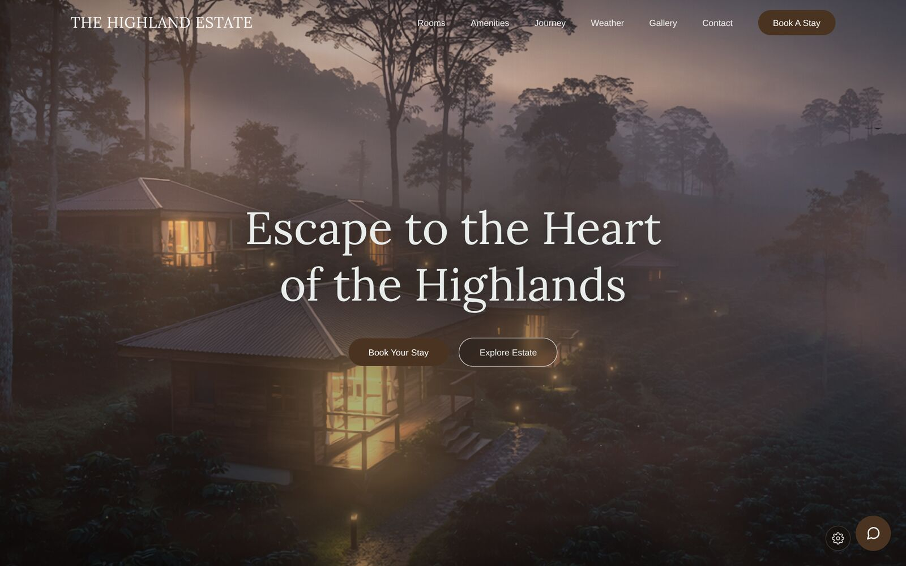
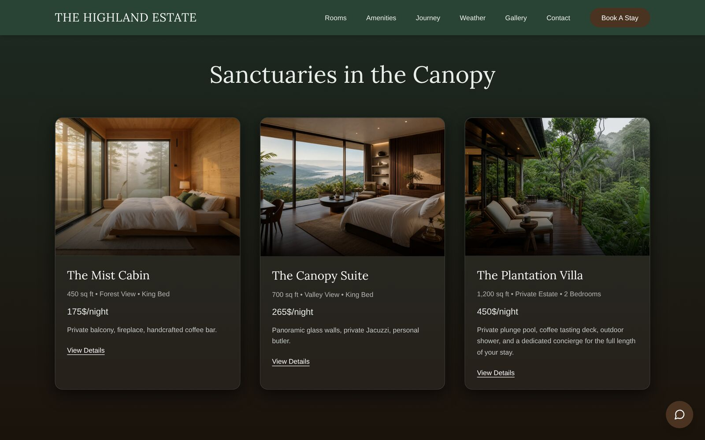
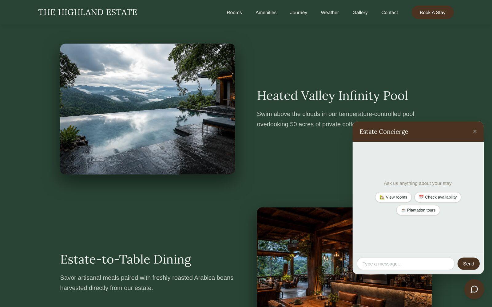

# The Highland Estate

**A fictional luxury coffee-estate resort site**, built with Next.js 16, React Three Fiber and Tailwind CSS. It has a live-weather 3D hero and an **LLM booking concierge** that checks availability, quotes prices and creates bookings through tool calls, with automatic failover across three model providers.



<table>
  <tr>
    <td width="50%"></td>
    <td width="50%"></td>
  </tr>
  <tr>
    <td>Rooms</td>
    <td>Estate Concierge (chat)</td>
  </tr>
</table>

<sub>Screenshots from a local production build (`next build && next start`) in Chromium at 1440×900. The hero uses WebGL; the other two were taken with the static fallback.</sub>

## What's interesting here

### Estate Concierge: a tool-calling LLM agent (`src/app/api/chat/route.ts`)
- **Scoped assistant.** The system prompt limits it to resort topics, with a fixed refusal for off-topic questions. Greetings are handled briefly, without pushing a booking.
- **Three tools:** `check_availability`, `calculate_price` and `create_booking`, backed by `src/lib/booking-data.ts`. The model must confirm availability and price with the guest before booking.
- **Provider failover:** Gemini 2.5 Flash, then Kimi (Moonshot), then Groq (`openai/gpt-oss-120b`). The three wire formats are normalized to one contract, so tool-call rounds work on any provider.
- **Failure handling:**
  - per-request timeouts
  - network errors and non-JSON gateway pages fall through to the next provider
  - quota exhaustion returns a friendlier 503
  - a booking completed on an earlier round is still reported even if a later round fails
- **Tests:** `route.test.ts` covers the failover cascade, timeouts, rate limits, malformed responses and a full tool-call round trip.

### Live-environment 3D hero (`src/components/hero3d/`)
- A photographic layered scene in React Three Fiber, with fog, fireflies, birds and rain, and a camera rig.
- A settings button switches time of day and weather. **Live** mode follows the real clock and OpenWeatherMap conditions for the estate's location (`/api/weather`, cached server-side).
- `useQualityTier` drops to a static poster for no-WebGL, reduced-motion, data-saver or very weak devices.
- `lib/hero-environment.ts` and `lib/hero-grade.ts` contain the time/weather logic and colour grading, with unit tests.

### Page sections
Rooms, amenities, a "journey" scene, live weather, gallery, testimonials and FAQ (`src/components/`).

## Run it

```bash
npm ci
cp .env.example .env.local   # add keys; everything is optional
npm run dev                  # http://localhost:3000
npm test                     # Vitest
npm run lint && npm run build
```

| Variable | Used by | Without it |
|---|---|---|
| `GEMINI_API_KEY` | Concierge, primary | Falls through to the next provider |
| `KIMI_API_KEY` | Concierge, fallback 1 | Falls through |
| `GROQ_API_KEY` | Concierge, fallback 2 | With no provider keys, the concierge returns an error message |
| `OPENWEATHERMAP_API_KEY` (alias `WEATHER_API_KEY`) | Live weather | Static climate data only |

## Limitations

- **Bookings are a demo:** they live in memory on the server and reset on redeploy. No payments.
- The resort, rooms and prices are fictional.

## Stack

Next.js 16 (App Router) · React 19 · TypeScript · Tailwind CSS 4 · React Three Fiber / three.js · Framer Motion · Vitest

## License

© 2026 Tawsif Khan. All rights reserved.
